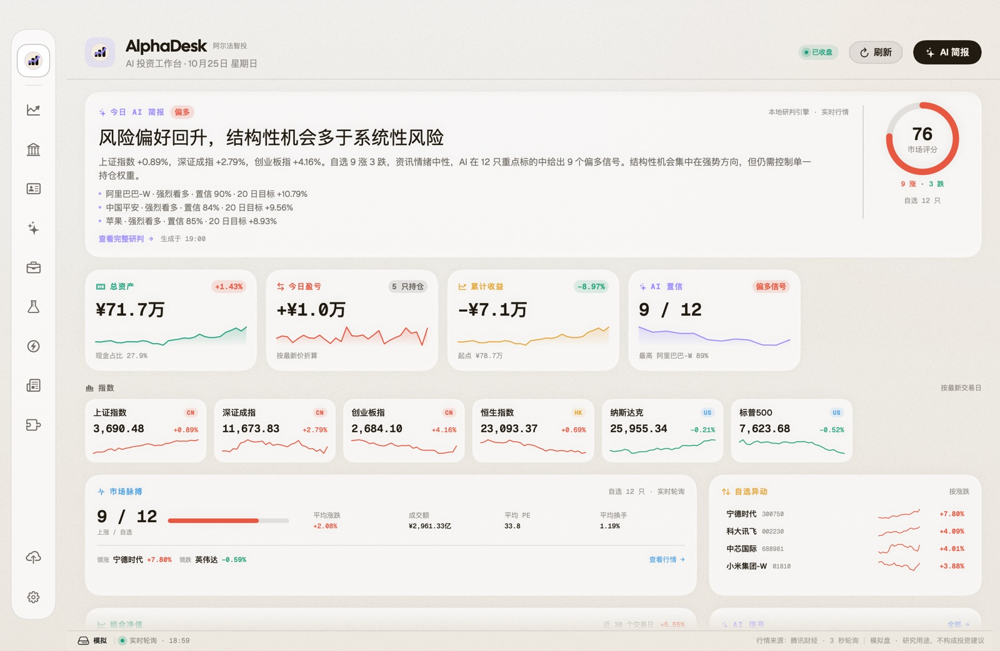
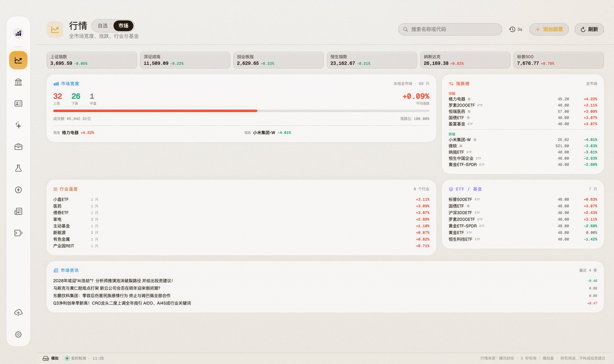
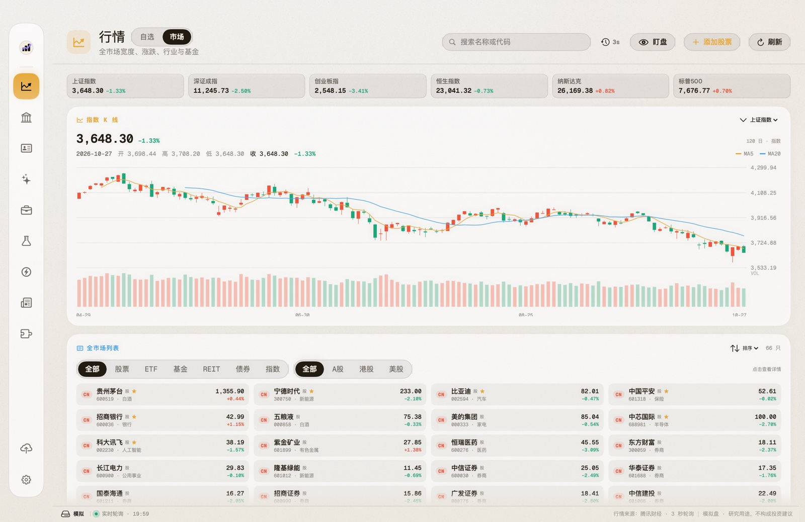
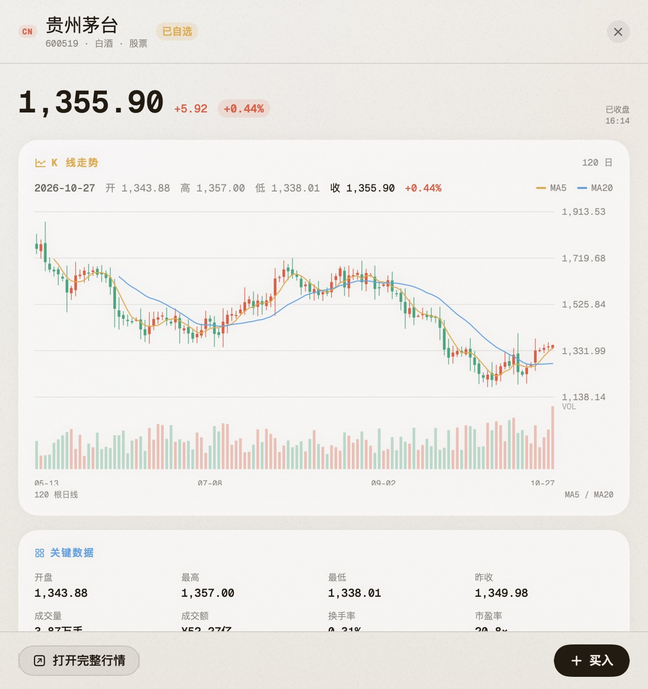
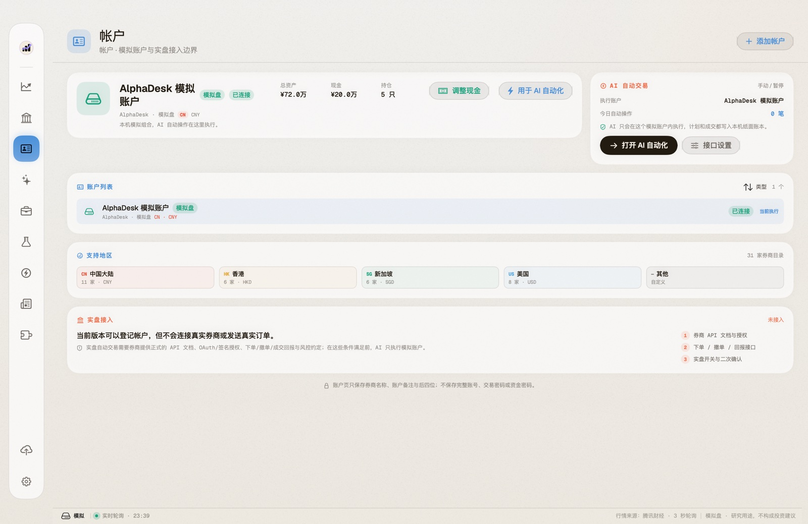
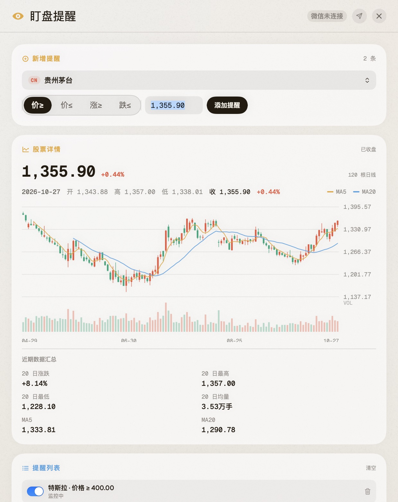
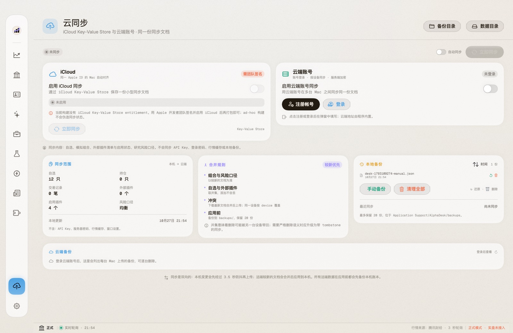
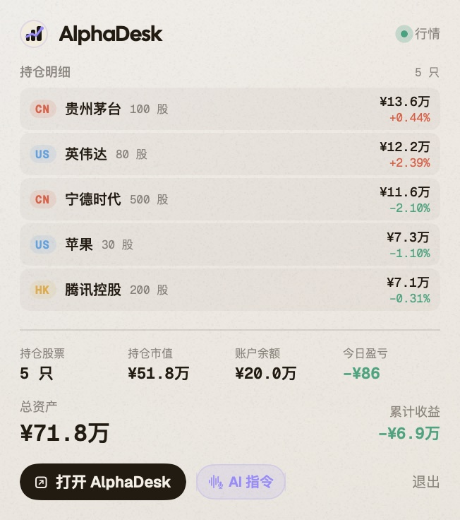

# AlphaDesk · AI 股票研究与模拟交易终端

AlphaDesk 是一款原生 macOS 股票研究、盯盘与模拟交易应用。它把行情、K 线、AI 研判、组合管理、条件提醒和纸面交易放在同一个本地优先的工作台里。

> 本项目仅发布编译后的应用、截图和说明，不包含源代码。

## 下载安装

1. 下载 `AlphaDesk-1.0.0-macOS-arm64.zip`；
2. 解压后把 `AlphaDesk.app` 拖入「应用程序」；
3. 首次打开如被 Gatekeeper 拦截，右键点击 App →「打开」，或在终端执行：

```bash
xattr -dr com.apple.quarantine /Applications/AlphaDesk.app
```

要求：Apple Silicon Mac，macOS 14 或更高版本。

## 功能

### 行情与盯盘

- A 股、港股、美股实时/延迟行情；
- 6 大指数条、自选列表和全市场列表；
- 日 K、成交量、MA5 / MA20、区间切换；
- 全市场标的按股票 / ETF / 基金 / REIT / 债券 / 指数和 A股 / 港股 / 美股筛选；
- 股票独立详情窗口，可同时打开多个；
- 盯盘价格/涨跌幅提醒，支持微信 Bot 推送和电脑声音提醒。

### 交易仿真

- 模拟买入/卖出票据，按最新公开费率计算佣金、印花税、过户费、SEC/TAF 等；
- 买入显示持仓成本、保本价和成交后现金；
- 卖出显示预计已实现盈亏；
- A 股 T+1、涨跌停价格、涨跌停排队；
- A 股/港股集合竞价；
- 交易时段、午休、周末与固定节假日校验；
- 排队订单查看和撤销。

### 研究与 AI

- 六因子研究引擎和本地规则解释；
- AI 研判、组合诊断和策略回测；
- 可选 OpenAI 兼容云端模型；
- 本地语音指令、微信 Bot 指令；
- 中英文界面。

### 组合与同步

- 模拟组合、持仓、交易记录和净值曲线；
- 一键卖出；
- 云端账号与 iCloud Key-Value Store 同步；
- 本地备份与一键清理；
- 只同步自选、组合、插件和风险口径，不同步密钥、密码和行情缓存。

## 截图

### 总览



### 行情 · 自选



### 全市场列表



### 股票详情与 K 线



### 帐户与模拟现金



### 盯盘提醒



### 云同步与本地备份



### 菜单栏小窗



## 边界

- AlphaDesk 只做模拟交易，不连接真实券商、不发送真实订单；
- 行情来自公开接口，可能延迟；
- AI 结论和研究内容不构成投资建议；
- 当前发布包为 ad-hoc 签名，不含 Apple 开发者签名和公证；
- 云端登录信息、API Key、组合和自选只保存在本机。

## 版本

`1.0.0` · macOS arm64

## 版权

AlphaDesk 保留所有权利。发布包可自由下载用于个人体验；未经许可不得重新分发或用于商业用途。
